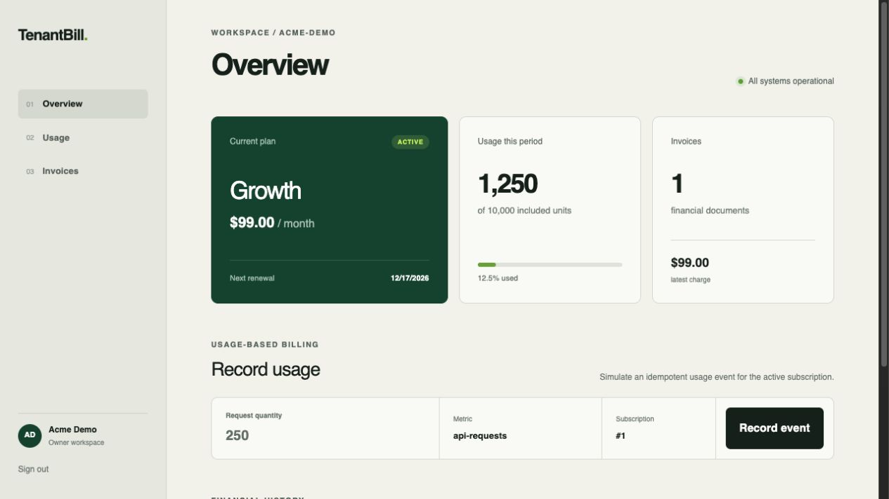
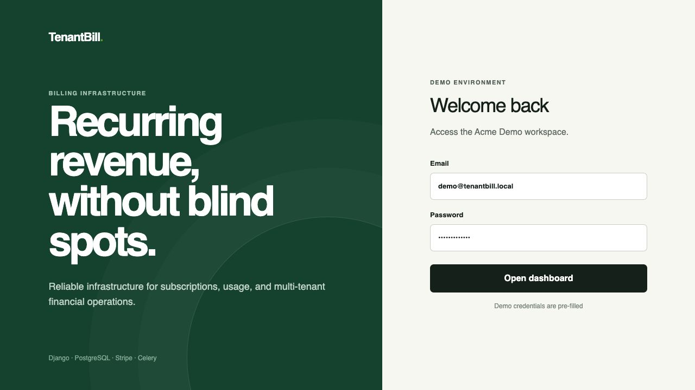
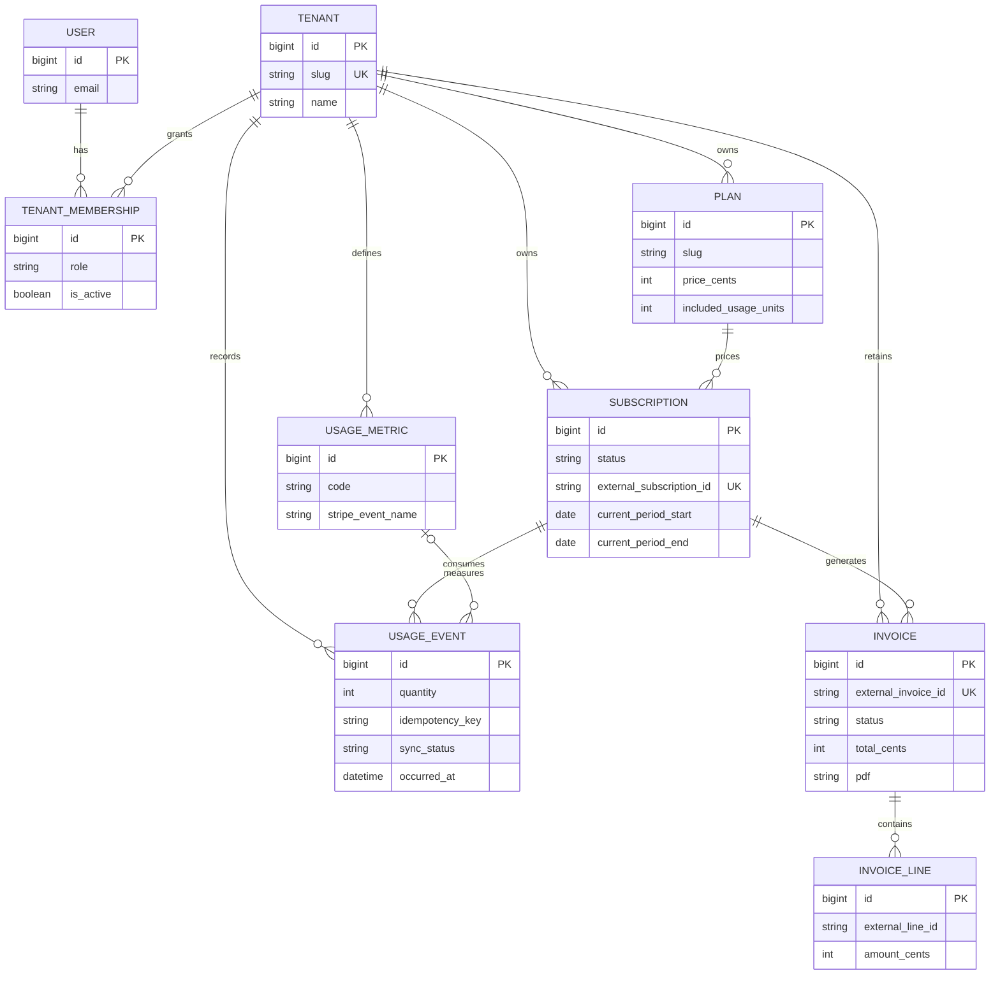
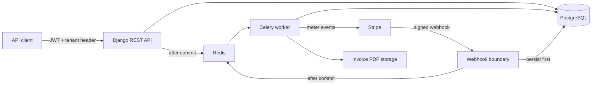

# TenantBill


[](https://github.com/lbraun7/tenant-bill/actions/workflows/ci.yml)


TenantBill is a project that demonstrates how to design the critical backend
infrastructure of a multi-tenant SaaS billing platform. Built with Django, PostgreSQL, Celery, and
Stripe, it supports recurring subscriptions, usage metering, local invoice history, and a small
Next.js dashboard for exploring the system.

Rather than presenting a complete commercial billing product, the project focuses on the failure
modes and engineering decisions that matter most in a real system: tenant isolation, idempotent
webhooks, immutable usage, asynchronous work, financial auditability, and operational traceability.

## Demo



<details>
<summary>View the demo sign-in screen</summary>



</details>

## What this project demonstrates

- Designing shared-schema multi-tenancy with tenant-scoped queries and cross-tenant security tests.
- Building persisted, idempotent webhook processing with retries, locking, and retained failures.
- Modeling usage as an append-only, auditable ledger with tenant-scoped idempotency.
- Isolating Stripe behind a mockable integration boundary instead of coupling it to API views.
- Coordinating database transactions with asynchronous Celery tasks and external side effects.
- Maintaining a local financial projection with invoice lines, generated PDFs, and storage
  abstraction.
- Making the system operable through structured logs, searchable Admin, OpenAPI, demo data, and
  coverage-gated CI.

## Engineering highlights

### Tenant isolation at the API boundary

Shared-schema tenancy is operationally simple, but a single unscoped query can expose another
customer's data. TenantBill resolves an active membership from the authenticated user and
`X-Tenant-Slug`, attaches the result to `request.current_tenant`, and scopes both querysets and
writable relationships to that tenant. Cross-tenant API tests cover list, retrieve, and write
attempts instead of relying on developer convention alone.

Explore the implementation in
[`apps/tenants/selectors.py`](apps/tenants/selectors.py),
[`apps/tenants/permissions.py`](apps/tenants/permissions.py), and
[`tests/test_tenant_isolation.py`](tests/test_tenant_isolation.py).

### Persist-before-process webhooks

Stripe can redeliver the same event, and a broker or worker can fail at any point. The HTTP
boundary therefore authenticates the raw payload and persists it under a unique provider event ID
before publishing any work. Publication happens after the database commit; workers claim events
under a row lock and retain processing status, attempts, timestamps, and errors. Repeated delivery
becomes a safe acknowledgement rather than a second financial operation.

Explore the implementation in
[`apps/webhooks/views.py`](apps/webhooks/views.py),
[`apps/webhooks/tasks.py`](apps/webhooks/tasks.py), and
[`tests/test_stripe_webhooks.py`](tests/test_stripe_webhooks.py).

### Usage as an immutable ledger

Usage is recorded as append-only events rather than mutable counters. Each logical event requires
a tenant-scoped idempotency key and must fall inside the subscription's current billing period.
Current totals are derived from the ledger, grouped by metric, so they remain explainable and can
be recomputed after a bug fix. Stripe meter synchronization is asynchronous and exposes its own
`pending`, `synced`, or `failed` state.

Explore the implementation in
[`apps/usage/models.py`](apps/usage/models.py),
[`apps/usage/serializers.py`](apps/usage/serializers.py), and
[`tests/test_usage_billing.py`](tests/test_usage_billing.py).

### Transaction-aware asynchronous work

Tasks that depend on newly written rows are scheduled with `transaction.on_commit()`, preventing a
fast Celery worker from reading data that has not committed yet. Provider synchronization, webhook
handling, and invoice PDF generation run outside the request path with bounded retries and
exponential backoff, while durable state makes failures visible to operators.

Explore the implementation in
[`apps/usage/tasks.py`](apps/usage/tasks.py),
[`apps/billing/tasks.py`](apps/billing/tasks.py), and
[`config/celery.py`](config/celery.py).

### Local financial projection behind a provider boundary

Stripe SDK calls are isolated in a small integration package instead of being spread through API
views. Webhook handlers translate provider events into local subscription and invoice state;
invoice lines are retained for auditability, and PDFs are generated through Django's storage
abstraction. Domain behavior can therefore be tested without live network calls while Stripe
remains the external source of payment truth.

Explore the implementation in
[`apps/integrations/stripe/client.py`](apps/integrations/stripe/client.py),
[`apps/billing/services.py`](apps/billing/services.py), and
[`tests/test_invoices.py`](tests/test_invoices.py).

The deeper reasoning and trade-offs are documented in
[Architecture decisions](docs/decisions.md).

## Domain model



Tenant ownership is explicit on every billing aggregate, even when it can also be reached through
another relationship. This deliberate redundancy keeps authorization queries direct and makes
cross-tenant invariants visible. `WebhookEvent` sits outside this ownership graph: it stores the
provider event before a handler resolves it to a local subscription or invoice.

## Architecture



The application uses shared database/shared schema tenancy. Stripe events are authenticated and
persisted before work is queued; workers claim records transactionally and update observable state.
See [architecture](docs/architecture.md) and [decisions](docs/decisions.md).

## Stack

| Area               | Technology                                                 |
| ------------------ | ---------------------------------------------------------- |
| API                | Python 3.12, Django 5, Django REST Framework, SimpleJWT    |
| Data               | PostgreSQL, Redis, Django storage                          |
| Async and payments | Celery, Stripe SDK, ReportLab                              |
| Quality            | pytest, factory_boy, branch coverage, Ruff, GitHub Actions |
| Delivery           | Poetry, Docker Compose, Gunicorn, OpenAPI/Swagger/Redoc    |

## Quick start

### Docker Compose (recommended)

With Docker and Docker Compose installed, start the complete stack and create deterministic demo
data:

```bash
docker compose up --build -d
docker compose exec api python manage.py seed_demo
```

The container entrypoint waits for PostgreSQL and applies migrations automatically. The stack
starts the Next.js dashboard, Django API, PostgreSQL, Redis, and a Celery worker.

| Service | URL |
| --- | --- |
| Portfolio dashboard | `http://localhost:3000` |
| API | `http://localhost:8000` |
| Swagger UI | `http://localhost:8000/api/docs/` |
| Django Admin | `http://localhost:8000/admin/` |

Sign in to the dashboard with:

```text
Email:    demo@tenantbill.local
Password: demo-password
Tenant:   acme-demo
```

The demo owner is not a Django staff user. To inspect operational data in Django Admin, create a
separate superuser:

```bash
docker compose exec api python manage.py createsuperuser
```

Inspect the application or stop it with:

```bash
docker compose logs -f api worker
docker compose down
```

### Local development

This path requires Python 3.12, Poetry, Node.js 22.13 or newer, and Redis. With no `.env` file,
Django uses SQLite and the Celery configuration points to Redis on `localhost`.

Start Redis, then run the API:

```bash
docker compose up -d redis
poetry install
make migrate
make seed
make runserver
```

In a second terminal, start the worker:

```bash
poetry run celery -A config.celery worker --loglevel=INFO
```

In a third terminal, start the dashboard:

```bash
cd frontend
npm ci
npm run dev
```

Do not copy `.env.example` unchanged for native execution: it uses the Docker-only hostnames `db`
and `redis`. To run PostgreSQL and Redis on the host, create a local `.env` and use `localhost` in
their connection URLs. The placeholder Stripe credentials are sufficient for exploring the local
projection; real meter synchronization and signed webhooks require Stripe test credentials.

## Explore the demo

1. Start the stack with `docker compose up --build -d`.
2. Create deterministic demo data with
   `docker compose exec api python manage.py seed_demo`.
3. Open the portfolio dashboard at `http://localhost:3000`.
4. Sign in with `demo@tenantbill.local` / `demo-password`.
5. Register a usage event and observe the current-period total increase immediately.
6. Inspect the invoice history, then explore the API at `http://localhost:8000/api/docs/`.

The seed command is idempotent, so the walkthrough can be prepared again without duplicating its
tenant, subscription, metric, or invoice fixtures. A longer request-by-request walkthrough is
available in [Demo walkthrough](docs/demo.md).

## Try the API

```bash
curl -sS http://localhost:8000/health/

curl -sS http://localhost:8000/api/auth/login/ \
  -H 'Content-Type: application/json' \
  -d '{"username":"demo@tenantbill.local","password":"demo-password"}'
```

Copy the access token and query tenant-scoped resources:

```bash
curl -sS http://localhost:8000/api/invoices/ \
  -H "Authorization: Bearer $TOKEN" \
  -H 'X-Tenant-Slug: acme-demo'
```

The complete demo, including usage ingestion, is in [docs/demo.md](docs/demo.md).

## API and operations

| Endpoint                 | Purpose                       |
| ------------------------ | ----------------------------- |
| `GET /health/`           | Process liveness              |
| `GET /api/schema/`       | OpenAPI schema                |
| `GET /api/docs/`         | Swagger UI                    |
| `GET /api/redoc/`        | Redoc                         |
| `POST /webhooks/stripe/` | Signed Stripe event ingestion |
| `/admin/`                | Operational domain inspection |

Logs are JSON by default. Webhook processing attempts, payloads, errors, invoice provider IDs, PDF
state, and usage synchronization failures are inspectable in Django Admin. See the
[operations runbook](docs/operations.md).

## Quality checks

Backend:

```bash
make lint
make test
make coverage
poetry run python manage.py spectacular --validate --fail-on-warn
```

Frontend:

```bash
cd frontend
npm run lint
npm test
```

CI enforces backend and frontend linting, both test suites, a warning-free OpenAPI schema, the
frontend production build, and at least 90% branch-aware backend coverage. The testing rationale is
documented in [docs/testing.md](docs/testing.md).

## Documentation

- [API reference](docs/api.md)
- [Architecture](docs/architecture.md)
- [Architecture decisions](docs/decisions.md)
- [Demo walkthrough](docs/demo.md)
- [Operations runbook](docs/operations.md)
- [Testing strategy](docs/testing.md)
