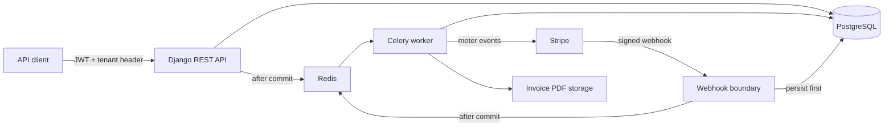

# TenantBill


TenantBill is a production-minded Django backend for recurring and usage-based SaaS billing. It
focuses on the dangerous parts of a real multi-tenant system: isolation, idempotent webhooks,
immutable usage, asynchronous work, financial history, and operational traceability.

## Why this project matters

- Shared-schema multi-tenancy with tenant-scoped querysets and cross-tenant security tests.
- Stripe behind a mockable integration boundary instead of calls spread through views.
- Persisted, idempotent webhooks with state, retries, locking, and retained failures.
- Append-only usage ledger with tenant-scoped idempotency and billing-period aggregation.
- Local invoice projection, auditable lines, asynchronous PDFs, and storage abstraction.
- JSON logs, searchable Admin, OpenAPI, demo data, Docker setup, and coverage-gated CI.

## Key engineering decisions

- **Explicit tenant resolution:** authenticated requests resolve an active membership from the
  `X-Tenant-Slug` header, and domain querysets are always scoped to that tenant.
- **Append-only usage:** consumption is recorded as immutable events instead of mutable counters,
  preserving the history needed to explain every aggregate.
- **Tenant-scoped idempotency:** usage keys are unique inside a tenant, preventing retries from
  counting the same logical event twice without coupling unrelated customers.
- **Persist webhooks before processing:** Stripe events are authenticated and stored before work is
  queued, so failures remain observable and can be retried safely.
- **External provider boundary:** Stripe-specific behavior lives behind a small integration client,
  keeping domain logic testable without real network calls.
- **Asynchronous side effects:** provider synchronization and PDF generation run in Celery workers,
  keeping API latency independent from slow external operations.
- **Local financial projection:** invoices and their lines are retained locally as an auditable
  history rather than being read exclusively from the payment provider.

The reasoning and trade-offs behind these choices are documented in
[Architecture decisions](docs/decisions.md).

## Architecture



The application uses shared database/shared schema tenancy. Stripe events are authenticated and
persisted before work is queued; workers claim records transactionally and update observable state.
See [architecture](docs/architecture.md) and [decisions](docs/decisions.md).

## Stack

| Area | Technology |
|---|---|
| API | Python 3.12, Django 5, Django REST Framework, SimpleJWT |
| Data | PostgreSQL, Redis, Django storage |
| Async and payments | Celery, Stripe SDK, ReportLab |
| Quality | pytest, factory_boy, branch coverage, Ruff, GitHub Actions |
| Delivery | Poetry, Docker Compose, Gunicorn, OpenAPI/Swagger/Redoc |

## Run locally

With Python 3.12 and Poetry installed:

```bash
poetry install
cp .env.example .env
make migrate
make seed
make runserver
```

Or start the API, PostgreSQL, Redis, and worker together:

```bash
docker compose up --build
docker compose exec api python manage.py migrate
docker compose exec api python manage.py seed_demo
```

The portfolio dashboard is available at `http://localhost:3000` and the API at
`http://localhost:8000`. The development-only seed login is
`demo@tenantbill.local` / `demo-password`, under tenant slug `acme-demo`.

## Explore the demo

1. Start the stack with `docker compose up --build`.
2. Create deterministic demo data with
   `docker compose exec api python manage.py seed_demo`.
3. Open the portfolio dashboard at `http://localhost:3000`.
4. Sign in with `demo@tenantbill.local` / `demo-password`.
5. Register a usage event and observe the current-period total increase immediately.
6. Inspect the invoice history, then explore the API at `http://localhost:8000/api/docs/`.

The seed command is idempotent, so the walkthrough can be prepared again without duplicating its
tenant, subscription, metric, or invoice fixtures. A longer request-by-request walkthrough is
available in [Demo walkthrough](docs/demo.md).

## Try the API

```bash
curl -sS http://localhost:8000/health/

curl -sS http://localhost:8000/api/auth/login/ \
  -H 'Content-Type: application/json' \
  -d '{"username":"demo@tenantbill.local","password":"demo-password"}'
```

Copy the access token and query tenant-scoped resources:

```bash
curl -sS http://localhost:8000/api/invoices/ \
  -H "Authorization: Bearer $TOKEN" \
  -H 'X-Tenant-Slug: acme-demo'
```

The complete demo, including usage ingestion, is in [docs/demo.md](docs/demo.md).

## API and operations

| Endpoint | Purpose |
|---|---|
| `GET /health/` | Process liveness |
| `GET /api/schema/` | OpenAPI schema |
| `GET /api/docs/` | Swagger UI |
| `GET /api/redoc/` | Redoc |
| `POST /webhooks/stripe/` | Signed Stripe event ingestion |
| `/admin/` | Operational domain inspection |

Logs are JSON by default. Webhook processing attempts, payloads, errors, invoice provider IDs, PDF
state, and usage synchronization failures are inspectable in Django Admin. See the
[operations runbook](docs/operations.md).

## Quality checks

```bash
make lint
make test
make coverage
poetry run python manage.py spectacular --validate --fail-on-warn
```

CI enforces lint, all tests, a warning-free OpenAPI schema, and at least 90% branch-aware coverage.
The testing rationale is documented in [docs/testing.md](docs/testing.md).

## Documentation

- [API reference](docs/api.md)
- [Architecture](docs/architecture.md)
- [Architecture decisions](docs/decisions.md)
- [Demo walkthrough](docs/demo.md)
- [Operations runbook](docs/operations.md)
- [Testing strategy](docs/testing.md)
- [Implementation roadmap](ROADMAP.md)
